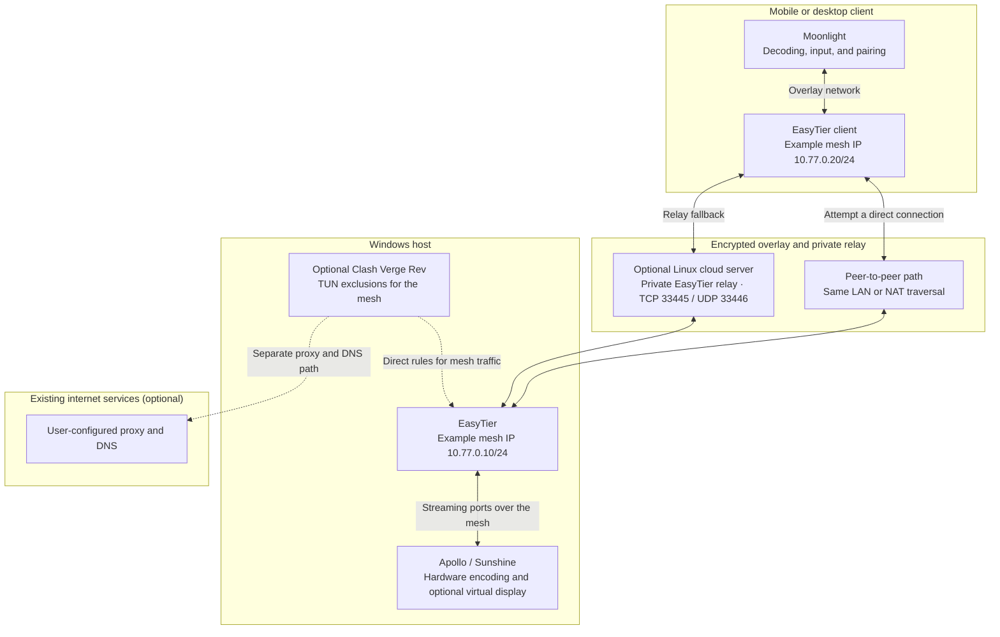

# Mesh Remote — Low-latency remote desktop for campus networks, with self-hosted relay support

[简体中文](README.md) · **English**

Mesh Remote combines **EasyTier encrypted networking**, **Apollo or Sunshine on a Windows host**, and **Moonlight on the client**. Laptops, phones, and tablets connect through a fixed virtual address. The project is designed for campus networks, shared Wi-Fi, and networks behind multiple layers of NAT. Devices can try a direct path and fall back to a private relay on a Linux cloud server.

1. **Reach a host across dorms, classrooms, and labs.** Wireless client isolation, VLAN boundaries, or restrictive NAT can prevent LAN discovery and inbound connections. Both devices can initiate connections to the same reachable private node. Add the host's virtual IP manually in Moonlight to pair. When a direct path is available, stream traffic can travel between devices directly. When it fails, the relay can carry the stream using the same virtual IP.
2. **Tune streaming to the link and hardware.** Apollo and Sunshine can use the host's hardware encoder, and compatible Moonlight clients can decode in hardware. Apollo's virtual display can match the client's resolution and aspect ratio. Start at 1080p and 60 FPS, then increase quality as the devices and link allow. Use EasyTier route information and Moonlight statistics to identify packet loss, latency, and bitrate limits.
3. **Work alongside existing proxy and DNS settings.** The EasyTier template keeps the system DNS settings, and the Windows client can bind to a physical interface. With a TUN proxy such as Clash Verge Rev, exclude the mesh subnet and relay address where needed. Scope incoming streaming rules to the mesh and keep the host's management UI on localhost.

[Quick start](docs/QUICK_START.md#english) · [Relay deployment and troubleshooting (中文)](docs/OPERATIONS_AND_TROUBLESHOOTING.md) · [Mobile setup (中文)](docs/HARMONYOS_AND_MOBILE_GUIDE.md)

## Architecture overview



On a campus network with peer connectivity, the nodes can use the LAN or try NAT traversal. With client isolation, check that both ends can reach the cloud relay. The template listens on TCP and UDP. The path depends on each network's policy and which ports are reachable. Relay latency depends on server location and path quality, and relay traffic may count toward the server's bandwidth allowance. [Network architecture and Tailscale alternative (中文)](docs/ARCHITECTURE.md)

## Components and versions

| Where | Component | Version or service name | Role |
| --- | --- | --- | --- |
| Windows host | Apollo or Sunshine | Apollo v0.4.6 is a reference version. Choose a compatible Sunshine build if you use Sunshine. | Streams to Moonlight and manages pairing and encoding. Apollo supports virtual displays. |
| Windows host | EasyTier | Templates checked with v2.6.4 | Provides a fixed virtual IP, selects a direct or relayed path, and keeps the system DNS settings. |
| Windows host (optional) | Clash Verge Rev | Check the TUN controls in your installed version. | Excludes the mesh subnet and relay addresses while preserving existing proxy and DNS rules. |
| Linux cloud server (optional) | Private EasyTier relay | `mesh-remote-relay.service`, systemd 247+ | Verifies mesh membership and provides a reachable node when direct connections fail. |
| Linux cloud server (optional) | vnStat and quota guard | vnStat 2.x, jq, `mesh-remote-quota.timer` | Monitors monthly interface transmit traffic and can warn or stop the relay at configured thresholds. |
| Client | EasyTier + Moonlight | Select builds for your platform. | Connects to the host's virtual address. Android has dedicated packages. HarmonyOS NEXT needs compatible native clients. |
| Alternative network | Tailscale / self-hosted DERP | Use your Tailnet and DERP region configuration. | Provides an alternative for existing Tailscale deployments. |

## Repository layout

```text
mesh-remote/
├── README.md                           # Chinese project overview
├── README.en.md                        # English project overview
├── AGENTS.md                           # Contribution and sanitization notes
├── .gitignore / .gitattributes          # Local-file exclusions and line endings
├── docs/
│   ├── QUICK_START.md                  # Bilingual quick start
│   ├── ARCHITECTURE.md                  # Network boundaries and Tailscale alternative
│   ├── OPERATIONS_AND_TROUBLESHOOTING.md # Relay, quotas, checks, and troubleshooting
│   └── HARMONYOS_AND_MOBILE_GUIDE.md    # HarmonyOS, Android, and streaming settings
├── easytier/
│   └── windows.example.toml            # Windows node configuration template
├── relay/
│   ├── relay.example.toml              # Private cloud relay template
│   ├── quota.conf.example              # Deployment-specific traffic limits
│   ├── check-traffic-quota.sh           # Monthly traffic thresholds and cutoff
│   └── systemd/                         # Relay, quota guard, and timer
├── windows/
│   ├── Set-StreamingFirewall.ps1       # Scope host inbound rules to the mesh
│   ├── Verify-Mesh.ps1                 # Check host TCP reachability from the mesh
│   ├── clash-verge-mesh-patch.js        # Idempotent Clash TUN and direct rules
│   ├── CLASH_CANDIDATES.md              # Clash setup and troubleshooting
│   └── sunshine-recommended.conf       # Management UI and optional NVIDIA settings
└── tailscale/
    └── derp-map.example.hujson          # Optional DERP region map
```

## Routine checks and commands

### 1. Check whether the streaming host is reachable

Replace the example IP with the host's virtual address and run this on another Windows device that has joined the mesh. Once the TCP check passes, pair and start a stream in Moonlight.

```powershell
.\windows\Verify-Mesh.ps1 -HostMeshIP 10.77.0.10
```

### 2. Inspect direct and relayed paths

Run these commands on the Windows node to inspect peers and routes. Use Moonlight's statistics for actual latency, dropped frames, and bitrate. Check the path again after roaming between campus access points.

```powershell
& .\easytier\win\easytier-cli.exe peer
& .\easytier\win\easytier-cli.exe route
```

### 3. Check the cloud relay and quota guard

Run these commands on the cloud server. If you installed the quota guard, check its timer and recent traffic logs.

```bash
systemctl is-active mesh-remote-relay.service
ss -lntu | grep -E ':(33445|33446)\b'
systemctl is-active mesh-remote-quota.timer
journalctl -u mesh-remote-quota.service -n 10 --no-pager
```

## Security and private data

- The examples use reserved domain names and sample private addresses. Store real relay addresses, network secrets, and machine-specific config in access-controlled locations. Use the Git-ignored `.local/` directory for private config kept inside a checkout.
- Redact device names, addresses, usernames, and credentials before sharing logs. Keep Apollo and Sunshine pairing state, proxy configurations, TLS keys, private deployment notes, and backups in the deployment environment.
- Manage private relay listener ports with your host firewall and cloud firewall rules. Limit streaming access to the mesh and the host's management UI to localhost. Obtain the platform binaries from their upstream projects.
