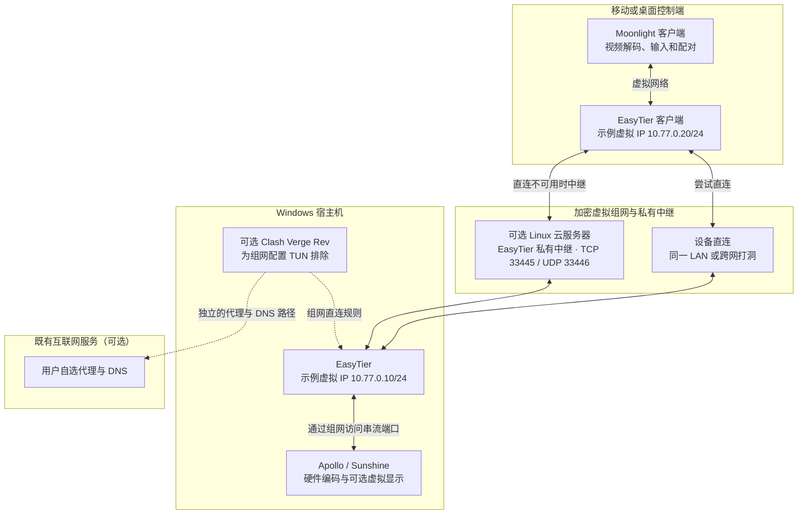

# Mesh Remote — 校园网低延迟远控，支持自建中继

**简体中文** · [English](README.en.md)

Mesh Remote 将 **EasyTier 加密组网**、**Apollo / Sunshine 主机串流**与 **Moonlight 客户端**组合起来，让笔记本、手机或平板通过固定的虚拟地址访问自己的 Windows 主机。项目面向校园网、公寓共享 Wi-Fi、运营商多层 NAT 等环境，支持尝试设备直连，也可在 Linux 云服务器上部署私有中继。

1. **适合宿舍、教室和实验室之间的远控。** 校园无线客户端隔离、跨 VLAN 或严格 NAT 会让局域网发现和入站连接失效。两端可以主动连接同一个可达的私有节点，Moonlight 通过手动添加宿主机的虚拟 IP 完成配对。直连可用时，串流数据可直接在设备间传输。直连失败时，可由云服务器中继，仍使用同一个虚拟地址。
2. **按链路和硬件调节串流。** Apollo / Sunshine 可使用宿主机的硬件编码，Moonlight 在支持的客户端上进行硬件解码。Apollo 的虚拟显示器可按客户端的分辨率和宽高比配置。可先用 1080p / 60 FPS 验证稳定性，再按设备和链路余量提高画质。用 EasyTier 的路径信息和 Moonlight 的串流统计定位丢包、延迟或码率瓶颈。
3. **与既有代理和 DNS 共存。** EasyTier 示例保留系统 DNS，Windows 客户端可绑定物理网卡。使用 Clash Verge Rev 等 TUN 代理时，可为组网网段和中继地址配置排除。Apollo / Sunshine 的入站规则可以限制在虚拟组网内，管理网页限制为本机访问。

[快速上手](docs/QUICK_START.md#简体中文) · [云端部署与排障](docs/OPERATIONS_AND_TROUBLESHOOTING.md) · [移动端配置](docs/HARMONYOS_AND_MOBILE_GUIDE.md)

## 整体架构概览



校园网两端能直接通信时，可使用 LAN 或打洞路径。存在设备隔离时，分别从两端核对云中继是否可达。模板提供 TCP 和 UDP 监听，实际路径由两端网络策略和可用端口决定。使用中继时，延迟受云服务器位置和链路影响，中继流量可能计入账单。[网络架构与 Tailscale 备选方案](docs/ARCHITECTURE.md)

## 核心组件与版本清单

| 端 | 组件 | 版本或服务名 | 主要职责 |
| --- | --- | --- | --- |
| Windows 宿主机 | Apollo 或 Sunshine | Apollo 可参考 v0.4.6，Sunshine 使用适合宿主机的版本 | 向 Moonlight 提供串流，管理配对和编码。Apollo 支持虚拟显示。 |
| Windows 宿主机 | EasyTier | 模板按 v2.6.4 校验 | 提供固定虚拟 IP、选择直连或中继路径，保留系统 DNS。 |
| Windows 宿主机（可选） | Clash Verge Rev | 按所用版本核对 TUN 界面设置 | 排除组网网段和所需中继地址，保留已有代理和 DNS 策略。 |
| Linux 云服务器（可选） | EasyTier 私有中继 | `mesh-remote-relay.service`，systemd 247+ | 校验组网身份，为难以直连的设备提供可达节点。 |
| Linux 云服务器（可选） | vnStat + 流量守护 | vnStat 2.x、jq、`mesh-remote-quota.timer` | 监控出口网卡月度发送量，达到配置阈值时告警或停止中继。 |
| 控制端 | EasyTier + Moonlight | 选择适用于各自系统的客户端 | 连接宿主机虚拟地址。安卓可用对应安装包，HarmonyOS NEXT 需要兼容的原生客户端。 |
| 备选组网 | Tailscale / 自建 DERP | 使用自己的 Tailnet 和 DERP 区域配置 | 为已有 Tailscale 部署提供另一条组网路径。 |

## 目录导航

```text
mesh-remote/
├── README.md                           # 中文项目总览
├── README.en.md                        # 英文项目总览
├── AGENTS.md                           # 贡献与脱敏约定
├── .gitignore / .gitattributes          # 本地资料排除与跨平台行尾
├── docs/
│   ├── QUICK_START.md                  # 中英双语快速上手
│   ├── ARCHITECTURE.md                  # 网络架构、安全边界与 Tailscale 备选
│   ├── OPERATIONS_AND_TROUBLESHOOTING.md # 中继、流量配额、验证与排障
│   └── HARMONYOS_AND_MOBILE_GUIDE.md    # HarmonyOS、Android 和串流调优
├── easytier/
│   └── windows.example.toml            # Windows 节点配置模板
├── relay/
│   ├── relay.example.toml              # 云服务器私有中继模板
│   ├── quota.conf.example              # 按部署环境填写的流量配额
│   ├── check-traffic-quota.sh           # 月度流量阈值与停止保护
│   └── systemd/                         # 中继、流量守护与定时器
├── windows/
│   ├── Set-StreamingFirewall.ps1       # 将串流程序入站规则限制到组网
│   ├── Verify-Mesh.ps1                 # 从组网内验证串流主机 TCP 可达性
│   ├── clash-verge-mesh-patch.js        # 可重复应用的 Clash TUN 和直连规则
│   ├── CLASH_CANDIDATES.md              # Clash 安装与排查
│   └── sunshine-recommended.conf       # 管理界面与可选 NVIDIA 编码设置
└── tailscale/
    └── derp-map.example.hujson          # 可选 DERP 区域映射模板
```

## 日常快速体检与常用命令

### 1. 从组网内检查串流主机可达性

把示例 IP 换成宿主机的虚拟地址，在另一台已入网的 Windows 设备上运行。TCP 检查通过后，可在 Moonlight 中完成配对和播放测试。

```powershell
.\windows\Verify-Mesh.ps1 -HostMeshIP 10.77.0.10
```

### 2. 查看直连、中继与链路质量

在 Windows 节点运行以下命令查看邻居、路由和路径，在 Moonlight 的串流统计中查看实际延迟、丢帧和码率。校园网切换接入点后，可重新检查路径。

```powershell
& .\easytier\win\easytier-cli.exe peer
& .\easytier\win\easytier-cli.exe route
```

### 3. 查看云中继与配额状态

在自己部署的云服务器上运行。安装了配额守护时，可同时查看定时器和计数日志。

```bash
systemctl is-active mesh-remote-relay.service
ss -lntu | grep -E ':(33445|33446)\b'
systemctl is-active mesh-remote-quota.timer
journalctl -u mesh-remote-quota.service -n 10 --no-pager
```

## 安全与敏感信息约定

- 项目示例使用保留域名和示例私网地址。实际中继地址、组网密钥与本机配置放在受访问权限保护的位置，仓库内的私有配置可放在 Git 忽略的 `.local/`。
- 分享日志前遮盖设备名、地址、用户名和凭据。Apollo / Sunshine 配对状态、代理配置、证书私钥、私有部署记录和备份留在部署环境。
- 私有中继的监听端口由防火墙和云安全组管理。串流入站限于组网，宿主机管理页限于本机。客户端二进制按平台从各自上游获取。
