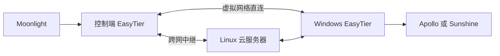

# 架构与网络边界

客户端使用 Windows 宿主机的虚拟 IPv4 地址。EasyTier 首选能够建立的直连，也可以通过私有中继转发。中继只需自己的监听端口，通常不需要虚拟地址或 TUN 设备。Windows 宿主机可限制串流程序的入站规则，使本地目标为宿主机虚拟地址、来源为组网网段。

组网密钥让设备加入同一个信任边界。每组设备使用独立强随机密钥，只通过受保护的渠道分发。控制端仍需完成 Moonlight 配对。示例启用私有中继模式，保留现有系统 DNS 和默认路由。

## Tailscale 备选方案

已使用 Tailscale 的部署者可直接用 Tailnet 地址连接 Moonlight，并用现有设备访问策略限制连接。确有自建中继需求时，按 [Tailscale 自建 DERP 文档](https://tailscale.com/docs/reference/derp-servers)部署，启用客户端验证，并为中继域名配置受客户端信任的 TLS 证书。

将 [DERP 映射模板](../tailscale/derp-map.example.hujson)中的区域合并到现有 derpMap。填写实际域名、端口和未占用的区域编号。保留 Tailnet 现有 ACL 和默认区域，按需使用 tailscale netcheck 验证。自建 DERP 与 EasyTier 是两条独立路径。
